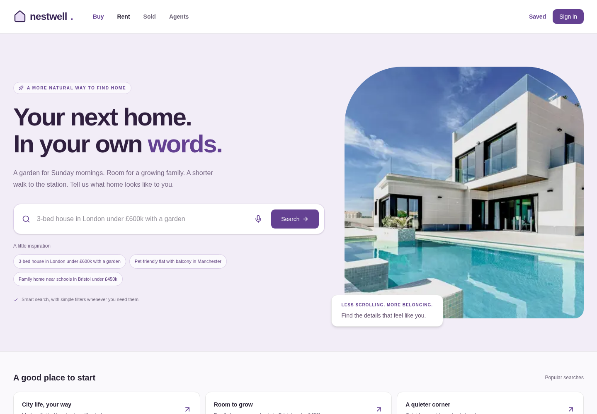
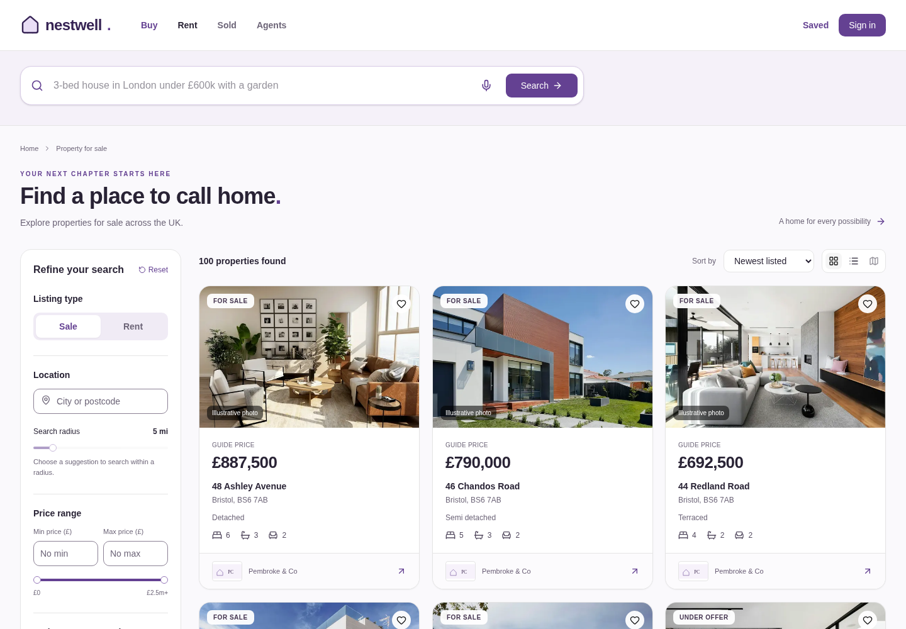
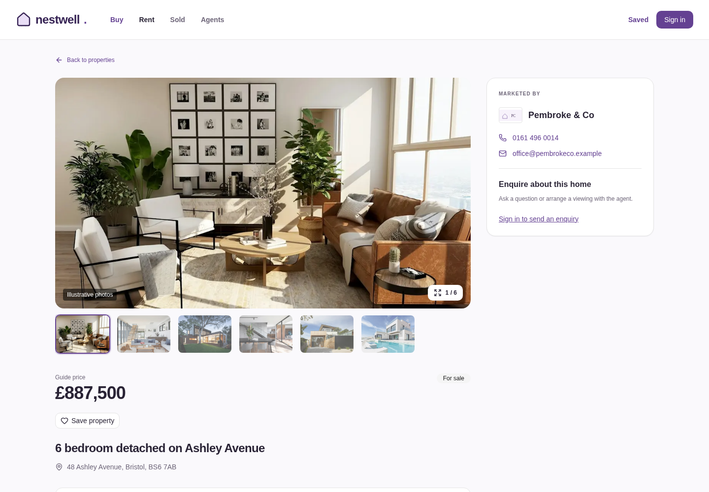

# Nestwell

A Zoopla-inspired UK property demo built with Next.js 15 App Router, React 19,
TypeScript, Tailwind CSS 4, shadcn/ui, Prisma 6, PostgreSQL 16 and Zod. Uses pnpm.
The flagship search accepts natural language and browser voice input, ranks
matching properties and explains matches. This repository covers Phases 1–6.

## Features

- 100 fictional properties across London, Manchester, Birmingham, Leeds and
  Bristol, five agents and two demo users; idempotent upserts and bundled photos.
- Public grid/list results, filters, autocomplete, pagination, URL state and
  keyboard-accessible mobile filter drawer. Prices in URLs are **pounds**;
  prices stored/returned in property records are **integer pence**.
- OpenAI structured parsing with a six-second deadline, deterministic no-key
  fallback, 24-hour PostgreSQL cache, per-call logs and ranked match reasons.
- Browser voice recognition with interim text, final transcript review, permission
  help and a typed-search fallback. Voice never submits automatically.
- Demo email sign-in, optimistic favorites, saved-search Run/Delete, authenticated
  enquiries, similar listings and browser-local recently viewed history.
- Optional Mapbox clustered map with synchronized selection, desktop split pane
  and a focus-trapped mobile map with a collapsible bottom list.
- Loading/error/empty states, branded 404/500 handling, generated metadata,
  robots/sitemap routes, reduced motion and visible keyboard focus.

## Screenshots





Screenshots show fictional demo listings and illustrative, bundled Unsplash photos.

## Architecture

```text
Browser: Next.js UI + TanStack Query + NextAuth session provider
  |-- Web Speech API --> reviewed text --> shared search submission
  |-- optional Mapbox GL JS --> public Mapbox token / clustered GeoJSON
  |
  v
Next.js App Router pages + API routes
  |-- Zod validation / origin checks / process-local rate limiters
  |-- NextAuth credentials --> encrypted HttpOnly session cookie
  |-- NL parser --> OpenAI gpt-4o-mini structured output (optional)
  |                 \--> regex fallback on missing key, refusal or timeout
  v
Prisma singleton --> PostgreSQL
  properties / agents / users / favorites / saved searches / enquiries
  SearchQuery: normalized hash cache + per-call audit records
```

Important source locations: `src/lib/search/`, `src/lib/properties.ts`,
`src/hooks/useVoiceSearch.ts`, `src/components/search/`, `src/lib/auth.ts`,
`src/app/api/`, `prisma/schema.prisma`, and `prisma/seed.ts`.

## Local setup

Requires Node.js **24 LTS (24.15+)** or **22 LTS (22.22.2+)**, pnpm 11,
and PostgreSQL 16. The supplied Compose user can create Prisma's shadow database.

```sh
git clone <your-repository-url> nestwell
cd nestwell
cp .env.example .env
# Optional: use the supplied local database.
docker compose up -d --wait
pnpm install
pnpm prisma migrate dev
pnpm db:seed
pnpm dev
```

Open http://localhost:3000 and http://localhost:3000/health. The seed produces
100 properties, five agents and two users; re-running it preserves those counts.
Demo users are `emma.wilson@example.com` and `oliver.taylor@example.com`.

```sh
pnpm build
pnpm start
```

Stop dev before building: both write `.next`. `pnpm db:migrate --name your_change`
creates a development migration. `pnpm prisma migrate deploy` applies checked-in
migrations in deployment. **`pnpm prisma migrate reset --force` deletes the target
database's application data**, reapplies migrations and automatically runs the
seed. Use it only against a disposable/local database. No migration reset is
needed for normal starts.

For an install-from-scratch check, create a separate empty database, point the
clone's `.env` at it, then run `pnpm install`, `pnpm prisma migrate reset --force`
and `pnpm dev`. Never point this check at a database whose data you want to keep.

### Environment variables

| Variable          | Purpose / default                                                          |
| ----------------- | -------------------------------------------------------------------------- |
| `DATABASE_URL`    | Required PostgreSQL connection string; see `.env.example`                  |
| `OPENAI_API_KEY`  | Optional server-only key; absent/unavailable uses fallback                 |
| `NEXTAUTH_SECRET` | Stable random secret for deployment; absent uses a per-process demo secret |
| `NEXTAUTH_URL`    | Actual app origin; local example is `http://localhost:3000`                |
| `SITE_URL`        | Optional canonical/SEO origin; defaults to `NEXTAUTH_URL`, then localhost  |
| `MAPBOX_TOKEN`    | Optional public `pk.` browser token; absent or `sk.` disables map          |
| `REDIS_URL`       | Reserved optional setting; current limiters are in memory                  |
| `TEST_BASE_URL`   | Optional running-server origin for integration/browser/audit commands      |
| `CHROME_PATH`     | Optional Chrome/Chromium executable for browser tests and Lighthouse       |

Secrets stay in ignored `.env` files. Generate a stable auth secret with
`openssl rand -base64 32`. Only a public Mapbox token is intentionally passed to
the browser. `pnpm check:secrets` checks built static bundles for server-only
secret references.

## Natural-language search

`POST /api/search/parse` accepts exactly `{ query: string }`, 1–300 characters.
It returns the parsed fields plus `cached`, `modelUsed` and `latencyMs`.
The schema covers intent, location/radius, GBP budget, bedrooms/bathrooms,
property types, features, soft/must-have/nice-to-have preferences, ambiguity,
up to three clarifying questions and confidence.

The system prompt interprets UK language: £600k means 600000 **pounds**, 2-bed
means a minimum of two bedrooms, under means a maximum budget, transport/schools
map to stored features, and quiet/modern/family-friendly guide soft ranking.
It prohibits invented locations, school ratings/counts and travel times.
OpenAI's strict wire schema uses nullable optional fields, then public Zod
validation removes nulls and checks bounds. Confidence is 0.9 for clear model
output, 0.65 for ambiguous model output, or 0.4 for the regex fallback.

The fallback extracts digit-based room bounds, prices, known features/types,
UK cities/postcodes and distances. Unresolved/non-UK locations produce no
invented UK match; garbage text uses a literal title/description keyword search.
Missing intent/location triggers clarifying questions. Hard bounds are retained.

Normalized Unicode/case/whitespace queries use SHA-256 `queryHash`. Validated
cache entries expire after a fixed 24 hours; hits do not extend expiry. Separate
audit rows log every call. Provider-configuration scope prevents adding/removing
a key from reusing the wrong parser's cache. In-process misses share provider
work. Cache/log failures do not crash parsing. Set retention/cleanup policies
before a real deployment.

Cost controls: at most one provider attempt, no SDK retries, a six-second timeout,
300-character inputs, caching, and 20 parse POST requests/minute/IP. An unavailable
or rate-limited parse falls back to keyword browsing with a toast. Limit direct
`GET /api/properties?q=...` requests at the production gateway as well.

### Filtering and ranking

`GET /api/properties` supports `listingType` (SALE default), city, postcode prefix,
`lat`/`lng`/`radiusKm`, priceMin/priceMax, bedsMin/bedsMax, bathsMin/bathsMax,
comma-separated propertyTypes/features, sort, page and pageSize (20 default,
maximum 50). Explicit filter values override inferred ones. Traditional feature
checkboxes AND-match; text features guide ranking unless marked must-have.

Hard location, price, rooms and type constraints apply first. Remaining properties
score 0–100: feature overlap 40, listing-word preference matches 30, target-price
closeness 15, recency over 90 days 15. Relevance sorting ranks the full candidate
set before pagination. Stable tie-breakers prevent paging drift. “Cheap” targets
the lowest candidate price. Reasons cite actual features or listing wording.

Natural-language queries default to relevance; traditional search defaults to
newest. Explicit price/newest sort orders remain available. URLs retain all
filters, sort/page/view and the raw query. `omit=...` records cleared inferred
chips; `featureMode=ranked|required` preserves feature intent across reloads.
Apply flushes the 300ms debounce; Reset restores default SALE results.

The following examples are covered by integration tests:

1. `3-bed house in London under £600k with a garden and parking`
2. `pet-friendly flat with balcony near a train station in Manchester`
3. `family home near good schools in Bristol under £450k`
4. `cheap studio` — clarification and affordable studios
5. `asdfgh` — graceful empty state

## Voice Search

Select the microphone, allow access and speak. The API uses `en-GB`, interim
results, `continuous=false`, `maxAlternatives=1`. Final text fills/focuses the
input. **Review/edit before Enter or Search**; voice never auto-submits. Typing
or Escape cancels capture and ignores late events. Unmount releases listeners
and recognition. Reduced motion disables pulse, transitions and placeholder
rotation. The first-use voice hint and general search tip persist dismissal in
localStorage when available.

| Browser       | Support                                                                                                     |
| ------------- | ----------------------------------------------------------------------------------------------------------- |
| Chrome / Edge | ✅ Where SpeechRecognition or webkitSpeechRecognition is exposed; policies/services may affect availability |
| Safari 14.1+  | ✅ Partial; device/browser speech and microphone permissions vary                                           |
| Firefox       | ❌ Normally unavailable; disabled mic with keyboard/hover tooltip and working typed search                  |

Use HTTPS or localhost. For denied permission, open the address-bar site controls
and allow Microphone; in Safari, check Settings → Websites → Microphone and OS
speech/dictation permissions. Check the browser's system privacy permissions,
connected mic and network, then reload. Managed devices may require administrator
help. The inline **How to enable** dialog includes these steps. Mic errors are
announced and toasted. Acoustic recognition/service availability require real-device
checks; automated tests simulate speech events. The optional backend recording/
Whisper fallback is **not implemented**, so no recording option is exposed.

## Accounts, saves and enquiries

Demo credentials accept any valid email and any/omitted demo password. Email
identity is **unverified**; replace this provider before using real accounts.
JWTs live only in HttpOnly, SameSite=Lax browser-session cookies, with a one-day
JWT expiry. A missing auth secret uses a per-process random value: restarts log
users out and multiple instances cannot share those sessions.

All favorite/saved-search reads and writes, and enquiry writes, require a
session. Ownership comes from the server session; body `userId` is rejected.
Favorites use per-user TanStack Query state with optimistic updates and targeted
rollback. `/saved` has favorite cards and saved-search Run/Delete actions.

| API                                     | Behavior                                                               |
| --------------------------------------- | ---------------------------------------------------------------------- |
| `GET/POST /api/favorites`               | Own collection / idempotently save `{ propertyId }`                    |
| `DELETE /api/favorites/:propertyId`     | Remove only own favorite                                               |
| `GET/POST /api/saved-searches`          | Own rows / `{ name?, rawQuery?, filters }`                             |
| `DELETE /api/saved-searches/:id`        | Own row only; foreign IDs return 404                                   |
| `POST /api/enquiries`                   | `{ propertyId, name, email, phone?, message, website? }`               |
| `GET /api/properties/:id`               | Full listing, images, agent, similarProperties                         |
| `GET /api/properties/:id/similar`       | Same city/type/listing type, ±30% price, ±1 bed, exclude self, limit 6 |
| `GET /api/locations/autocomplete?q=...` | Up to eight DB-derived city/postcode matches                           |

Provided saved-search names are unique per user; unnamed saves are independent.
Replay preserves URL overrides/omissions and converts legacy seed price/room
aliases. Enquiries validate before storage; success confirms platform receipt,
not an agent email notification. A honeypot simulates success without storing bot
submissions. Enquiry attempts are limited to one per ten seconds/IP. Auth POSTs
are limited to 20/minute/IP; auth GETs to 120/minute/IP. NextAuth handles auth
CSRF; other mutation routes reject supplied cross-origin Origin headers.

Limiters are process-local. Multi-instance production needs a shared limiter
such as Redis and trusted ingress that overwrites forwarded IP/host headers.
The app does not yet use `REDIS_URL`.

## Map and recently viewed

Configure a public `MAPBOX_TOKEN=pk.…` and restart. Secret tokens are never sent
to the client. Map fetches every filtered page, clusters GeoJSON points at low
zoom, synchronizes pin/card selection and links popups to details. Desktop uses
a split pane; mobile uses a full-screen dialog/bottom list. Connection/token/
WebGL errors offer Grid/List alternatives. Without a token Map stays disabled.
Live Mapbox rendering requires a valid token; SDK behavior is covered with mocks.

Details record the last eight unique IDs in `nestwell.recently-viewed.v1`.
The home strip is browser-local, independent of account favorites, and handles
malformed/unavailable storage. Missing/empty results have browse/reset actions.

## Tests and QA

```sh
pnpm lint
pnpm test                  # Vitest, provider and map SDK mocked
pnpm test:integration      # Running server + disposable seeded database
pnpm exec playwright install chromium
CHROME_PATH=/usr/bin/chromium pnpm test:browser
pnpm build
pnpm check:secrets
# Start pnpm start in another terminal, then run sequential mobile audits:
CHROME_PATH=/usr/bin/chromium pnpm audit:quality
```

Run integration/browser tests against an isolated database: cache-expiry tests
update uniquely tagged test cache rows; account tests create/remove temporary
users and briefly modify/restore seeded favorites. Two isolated seeded-user
sessions verify ownership. Tests also cover all five NL examples, fallback/
timeout/cache paths, validators, filter combinations, rate rejection, voice
lifecycle, URL history, focus traps, optimistic rollback and persisted saves.

`audit:quality` audits home/results/detail sequentially with Lighthouse mobile
simulated throttling and enforces Performance 85, Accessibility 95, Best Practices
90 and SEO 90. Reports go to ignored `work/quality/`. Accessibility-only checks
remain available as `pnpm audit:a11y`. Scores measure this build/environment,
not universal real-device performance or a complete accessibility certification.

Database measurements and index rationale are in [docs/QUERY_PLANS.md](docs/QUERY_PLANS.md).
Final verified results and manual-check limits are in [docs/QA.md](docs/QA.md).

## Known limitations and next steps

- Fictional inventory and illustrative photos, not a licensed live feed. The seed
  contains sale listings only. Agree a rental price period before importing rents.
- Demo email identity; no verified accounts, agent portal or notification delivery.
- In-memory rate limits and in-process provider deduplication; no shared Redis yet.
- Regex fallback is intentionally limited and digit-based; confidence is heuristic.
- Rank-in-memory is appropriate for the demo dataset. Large feeds need indexed
  retrieval/geocoding, query-log retention and measured semantic-search evaluation.
- Coordinates/centroids approximate seeded neighbourhoods; no school quality,
  journey-time or precise geocoding claims.
- Native speech depends on browser/service/permissions. Live OpenAI, microphone
  accuracy and Mapbox tiles require configured credentials and real-device checks.
- LocalStorage history is browser-local. Health is a development diagnostics route
  and should be restricted/removed for public deployment.

See [ROADMAP.md](ROADMAP.md) for feed integrations, verified auth/agent tools,
semantic search, mortgage estimates, alerts, geocoding, i18n and dark mode.
